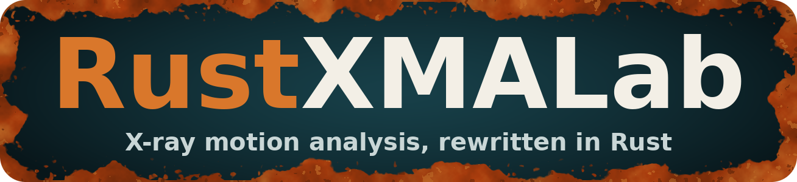

# RustXMALab

RustXMALab is a program for marker-based XROMM (X-ray Reconstruction of Moving
Morphology): it tracks radio-opaque markers in X-ray video from two or more
cameras and reconstructs their 3D positions and the motion of rigid bodies. It
is a rewrite in Rust of [XMALab](https://github.com/XROMMPackages/xmalab), keeps
XMALab 3's layout and workflow, and opens and saves the same project files
(`.xma`), so XMALab 3 can open projects saved here and the other way round.

**Status: 0.1.0, an early release.** Everything XMALab 3 does in daily use is
there, apart from a few exports. Calibration, undistortion, tracking and
editing have been checked against XMALab 3 on real data, but the program has
had little use on real projects yet, and the Windows and macOS builds have not
been tried. Check results that matter against XMALab, and please report what
goes wrong.

## What is new

- **Multi-camera tracking**: every marker is followed in all cameras together,
  so a point is accepted only where the cameras agree; doubtful points are left
  empty instead of filled with a wrong position.
- **Undo and redo** for every change, an unsaved-changes mark, safe saving and
  an autosaved recovery copy.
- **Results that do not depend on the machine**: settings that change results
  are stored in the project.
- **Images deeper than 8 bits** are tracked at their full depth.
- **Export to Blender**: cameras, images, rigid bodies, meshes and 3D points as
  a Blender scene.
- **The filter cutoff you enter is the real cutoff** of the two-pass filter.
- Known faults of XMALab 3 are fixed.

Some results therefore differ from XMALab's on purpose (filtered data most
noticeably). [Coming from XMALab 3](docs/for-xmalab-users.md) lists every
difference and when it matters; [the parity ledger](docs/parity-ledger.md)
gives the full record behind each one.

## Download

Ready-made programs are on the
[Releases page](https://github.com/pfalkingham/RustXMALab/releases):

| System | Installer | Portable (unpack and run) |
|---|---|---|
| Windows, 64-bit PC | `rustxmalab-<version>-x86_64-windows-setup.exe` | `rustxmalab-<version>-x86_64-windows.zip` |
| macOS, Apple Silicon, macOS 11 or later | `rustxmalab-<version>-aarch64-macos.dmg` | `rustxmalab-<version>-aarch64-macos.tar.gz` |
| Linux, 64-bit PC | `rustxmalab-<version>-x86_64.AppImage`, or `rustxmalab_<version>_amd64.deb` for Ubuntu and Debian | `rustxmalab-<version>-x86_64-linux.tar.gz`, with a menu entry; see its `INSTALL.txt` |

- **Windows:** run the setup program. It installs into
  `C:\Program Files\RustXMALab` (so it asks for administrator rights) and
  adds RustXMALab to the Start menu. The
  installer is not yet signed, so Windows may say "Windows protected your PC":
  click "More info", then "Run anyway".
- **macOS:** open the `.dmg` and drag RustXMALab to Applications. The app is
  not yet signed by Apple, so the first time you open it macOS refuses; go to
  System Settings › Privacy & Security, scroll down and click "Open Anyway"
  beside RustXMALab. After that it opens normally. The command-line program is
  inside the app, at `RustXMALab.app/Contents/MacOS/xma`.
- **Linux:** the AppImage is one file: make it executable (`chmod +x`, or
  the file's Properties) and open it. It needs FUSE 2, which some recent
  systems lack (`sudo apt install libfuse2` on Ubuntu). On Ubuntu and Debian
  the `.deb` installs RustXMALab with its menu entry (`sudo apt install
  ./rustxmalab_<version>_amd64.deb`). All Linux downloads need glibc 2.35 or
  later (Ubuntu 22.04 or newer).
- **Portable archives:** unpack anywhere and run `rustxmalab` (the window) or
  `xma` (the command-line program). On macOS the bare programs are blocked
  until you run `xattr -d com.apple.quarantine rustxmalab xma` once in
  Terminal in the unpacked folder; the `.dmg` avoids that.

Uncompressed and MJPEG AVI, Phantom `.cine` and image sequences are read
directly. Other videos (H.264, HEVC) need [FFmpeg](https://ffmpeg.org)'s
`ffmpeg` and `ffprobe` programs installed; nothing of FFmpeg is built in.

## Documentation

- [The user manual](https://github.com/pfalkingham/RustXMALab/wiki) (the wiki),
  starting with
  [Getting Started](https://github.com/pfalkingham/RustXMALab/wiki/Getting-Started).
- [Coming from XMALab 3](docs/for-xmalab-users.md): what differs for a user of
  XMALab 3, in summary and in detail.
- [The command-line program `xma`](https://github.com/pfalkingham/RustXMALab/wiki/Command-Line-Program-xma):
  information, recomputing, exporting, tracking, calibrating, denoising and
  undistorting without the window. `xma --help` lists every command.

## Example data

[`examples/pig/`](examples/pig/) holds the pig dataset, the standard example
for XMALab: two X-ray videos, undistortion grids, calibration images and the
cube's files, the CT marker coordinates and the bone meshes. It is enough to
build a project from scratch as the manual describes.

## Building from source

Install Rust (edition 2024, Rust 1.99 or later) and run

    cargo build --release

The programs are `target/release/rustxmalab` and `target/release/xma`. No C or
C++ compiler and no system libraries beyond the desktop's own are needed: the
program is pure Rust, and `cargo xtask depcheck` checks that no dependency
compiles native code.

## Citing

If you publish research done with this program, please cite the validation
paper of the original XMALab:

> Knörlein, B. J., Baier, D. B., Gatesy, S. M., Laurence-Chasen, J. D. and
> Brainerd, E. L. (2016). Validation of XMALab software for marker-based
> XROMM. *Journal of Experimental Biology* 219, 3701-3711.
> [doi:10.1242/jeb.145383](https://doi.org/10.1242/jeb.145383)

GitHub's "Cite this repository" button gives the same reference
([CITATION.cff](CITATION.cff)).

## Faults and ideas

Please open an [issue](https://github.com/pfalkingham/RustXMALab/issues) for
a crash, a wrong result or an idea. The manual's
[Reporting Faults](https://github.com/pfalkingham/RustXMALab/wiki/Reporting-Faults)
page says what to include.

## Credits and licence

RustXMALab is based on XMALab, written by Benjamin Knörlein, and was
rewritten in Rust by Peter Falkingham. It was written with
Claude, Anthropic's AI model, working in Claude Code under Peter Falkingham's
direction; its results were checked against XMALab 3 and against data tracked
by hand.

Licence: GPL-3.0-only, see [LICENSE](LICENSE). [NOTICE.md](NOTICE.md) gives
the origin of every piece of ported code and its licence.
